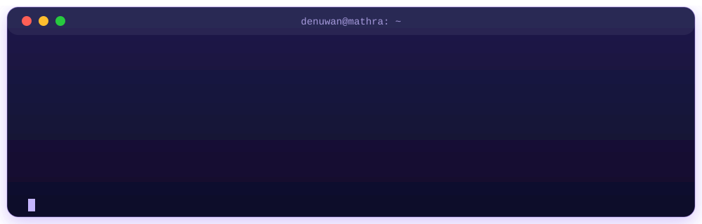

<!--
  ⚙️ This README is generated automatically by .github/workflows/update-readme.yml
  ✏️ Edit README.template.md (and profile.config.json), NOT README.md.
-->

<div align="center">



<a href="https://git.io/typing-svg">
  
</a>

<br/>

<sub>📍 **Colombo, Sri Lanka** &nbsp;•&nbsp; 💼 **Software Engineer** &nbsp;•&nbsp; 🗣️ සිංහල · English</sub>

<br/>


<a href="https://www.tiktok.com/@mathra_quotes_1"></a>

<br/><br/>



</div>


## 📸 &nbsp;Meet Me

<div align="center">



<br/>

### Denuwan Akash

<sub>Software Engineer · Android Developer · Colombo, Sri Lanka</sub>

<br/>


</div>


## 👨‍💻 &nbsp;About Me

<div align="center">
  
</div>

```kotlin
object DenuwanAkash {
    val name   = "Denuwan Akash"
    val brand  = "mathra Quotes"
    val role   = "Software Engineer · Android Developer"
    val from   = "Colombo, Sri Lanka 🇱🇰"
    val speaks = listOf("සිංහල", "English")

    val crafts = listOf(
        "📱 Android keyboard apps (IME)",
        "🤖 WhatsApp bots",
        "🌌 Immersive 3D web experiences"
    )

    val motto = "Code with heart. Design with soul."
}
```

> 👋 &nbsp;**Hi, I'm Denuwan Akash** — a **Software Engineer** based in **Colombo, Sri Lanka**. Under the **mathra Quotes** brand I build Android keyboards, WhatsApp bots and 3D web experiences that feel alive.

> 💜 &nbsp;**සිංහලෙන්:** මම දෙනුවන් ආකාශ් — කොළඹ ඉන්න Software Engineer කෙනෙක් සහ Android developer කෙනෙක්. **mathra Quotes** brand එක යටතේ keyboard apps, WhatsApp bots, සහ හැඟීම් ඇති 3D web අත්දැකීම් හදනවා.


## 🚀 &nbsp;What I Build

<div align="center">
  
</div>

<br/>

<table>
<tr>
<td width="50%" valign="top">

### ⌨️ MATHRA KEYBOARD
A production **Android IME** with multi-language layouts — including **Sinhala** — smooth typing and a custom look.


</td>
<td width="50%" valign="top">

### 🤖 WhatsApp Bot
**Baileys-based** WhatsApp bot with a pairing-code website that makes connecting simple.


</td>
</tr>
<tr>
<td width="50%" valign="top">

### 🌌 3D Web Experiences
Cinematic, interactive websites — **Three.js** scenes, particles, glow, and rich Sinhala typography.


</td>
<td width="50%" valign="top">

### 🌐 Community Web Apps
Themed community sites with member cards, hidden admin panels and **Supabase** backends.


</td>
</tr>
</table>


## 🧰 &nbsp;Tech Stack

<p align="center"><b>📱 Mobile</b></p>
<p align="center">
  
  
  
</p>

<p align="center"><b>🖥️ Backend &amp; Data</b></p>
<p align="center">
  
  
  
  
</p>

<p align="center"><b>🌐 Web &amp; 3D</b></p>
<p align="center">
  
  
  
  
</p>

<p align="center"><b>🛠️ Tools</b></p>
<p align="center">
  
  
</p>


## 🪐 &nbsp;Tech Orbit

<div align="center">
  
</div>


## 🔥 &nbsp;Recently Updated <sub>(auto-updated daily)</sub>

_No public repositories yet. Your first project will show up here automatically._ ✨


## 📊 &nbsp;GitHub Stats

<div align="center">


</div>


## 🐍 &nbsp;Contribution Snake

<div align="center">

<picture>
  <source media="(prefers-color-scheme: dark)" srcset="https://raw.githubusercontent.com/denuvan-akash/denuvan-akash/output/github-snake-dark.svg" />
  <source media="(prefers-color-scheme: light)" srcset="https://raw.githubusercontent.com/denuvan-akash/denuvan-akash/output/github-snake.svg" />
  
</picture>

</div>


## 🤝 &nbsp;Let's Connect

<div align="center">

<h3>💡 Have an idea? Let's turn it into something that feels alive.</h3>

<sub>අදහසක් තියෙනවද? එකට හදමු. 🚀</sub>

<br/><br/>

<a href="https://www.tiktok.com/@mathra_quotes_1"></a>
<a href="https://wa.me/94783756055"></a>
<a href="https://github.com/denuvan-akash?tab=repositories"></a>

<br/><br/>

### 💜 *"ඔයාගේ අදහස්, මගේ code එකෙන් ජීවය ගන්නවා."*

<sub>✨ Today's line: **අලුත් අදහසක් කියන්නේ අලුත් app එකක පළවෙනි commit එක.**</sub>

</div>


<div align="center">
  <sub>Made with ❤️ by <b>Denuwan Akash</b> • <b>mathra Quotes</b> &nbsp;|&nbsp; 🤖 auto-updated 2026-10-31 07:02 (UTC+05:30)</sub>
</div>
